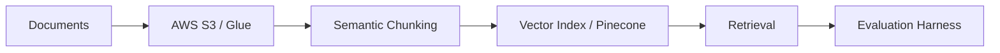
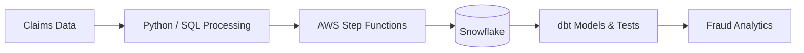

# 🚀 Engineering Projects

**Enterprise data pipelines built for analytics, retrieval, and reliability.**

[← Back to Portfolio](../README.md) · [Experience](experience.md) · [Tech Stack](tech-stack.md)

---

## 🧠 Enterprise RAG Data Pipeline & Evaluation Harness

**Repository:** [github.com/sumitingaleSplendid/enterprise-rag-pipeline](https://github.com/sumitingaleSplendid/enterprise-rag-pipeline)

     

### What It Demonstrates

- Ingestion and preprocessing of document data for downstream retrieval.
- Semantic chunking and vector indexing using LlamaIndex and Pinecone.
- AWS S3 and Glue components for cloud data workflows.
- Airflow orchestration of data processing steps.
- Evaluation-oriented workflows for RAG response and retrieval quality.

### Conceptual Workflow

[**Explore repository →**](https://github.com/sumitingaleSplendid/enterprise-rag-pipeline)

---

## 🏦 Claims & Fraud Benchmark Data Platform

**Repository:** [github.com/sumitingaleSplendid/claims-fraud-platform](https://github.com/sumitingaleSplendid/claims-fraud-platform)

    

### What It Demonstrates

- Claims and fraud-focused data processing pipelines.
- Workflow coordination using AWS Step Functions.
- Snowflake-based storage and analytics models.
- dbt transformations and SQL validation.
- Repeatable benchmark-oriented data preparation.

### Conceptual Workflow

[**Explore repository →**](https://github.com/sumitingaleSplendid/claims-fraud-platform)

---

[← Back to Main Portfolio](../README.md)

