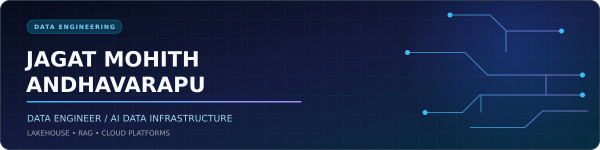
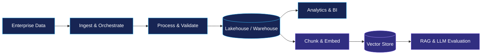

 

  

---

### ✦ Explore My Portfolio

**[🏠 Overview](README.md)** &nbsp; • &nbsp; **[💼 Experience](Pages/experience.md)** &nbsp; • &nbsp; **[🚀 Projects](Pages/projects.md)** &nbsp; • &nbsp; **[🎓 Education](Pages/education.md)** &nbsp; • &nbsp; **[🧰 Tech Stack](Pages/tech-stack.md)**

---

## 👋 The Engineer Behind the Pipelines

> **I engineer the data foundations that make analytics faster and AI systems more reliable.**

I'm **Jagat Mohith Andhavarapu**, a USA-based **Data Engineer** with **5+ years of experience** delivering enterprise ETL/ELT systems, cloud lakehouses, and production-oriented **Retrieval-Augmented Generation (RAG)** infrastructure. I work across **AWS, Azure, Databricks, and Snowflake**, connecting large-scale data processing with semantic retrieval, orchestration, and measurable business outcomes.

- 🏦 **Now:** AI Data Engineer at **First Citizens Bank** — enterprise document pipelines, Delta Lake, and RAG data infrastructure.
- ⚙️ **Specialties:** PySpark, Python, SQL, dbt, Airflow, Kafka, data modeling, and pipeline reliability.
- 🧠 **AI infrastructure:** Semantic chunking, vector search, Pinecone, document retrieval, and automated LLM evaluation.
- ☁️ **Cloud & platform:** AWS S3/Glue/Athena/Lambda/EMR, Azure Data Factory, Kubernetes, Terraform, Databricks, Snowflake.
- 🎯 **Engineering mindset:** Design for correctness, production readiness, performance, and maintainability.

### ✦ Selected Business Impact

| **500 GB/day** | **10× faster** | **40% less** | **25% lower** |
|:---:|:---:|:---:|:---:|
| Databricks + Delta Lake processing | Enterprise analytics | Manual document review | Pipeline latency |

| **2.5× faster** | **45% improvement** | **2+ TB/month** |
|:---:|:---:|:---:|
| Delta Lake reporting | Operational efficiency | Distributed data processing |

---

## 🧰 Technology Constellation

**Programming • Cloud • Infrastructure • Developer Tools**

  

**Data Engineering & Modern Lakehouse**

  

**AI Data Infrastructure & Retrieval**

 

**[View Full Technology Stack →](Pages/tech-stack.md)**

---

## 🚀 Featured Builds

<table>
<tr>
<td width="50%" valign="top">

<h3 align="center">🧠 Enterprise RAG Pipeline</h3>

**Document ingestion → semantic search → evaluation**

- Semantic document processing and chunking
- Cloud ingestion through **AWS S3 + Glue**
- **Pinecone** vector retrieval and **LlamaIndex**
- **Airflow** orchestration and evaluation workflows

  

</td>
<td width="50%" valign="top">

<h3 align="center">🏦 Claims & Fraud Platform</h3>

**Cloud orchestration → governed models → analytics**

- Claims and fraud-oriented data processing
- **AWS Step Functions** workflow orchestration
- **Snowflake** analytics-ready data modeling
- **SQL + dbt** transformations and quality rules

  

</td>
</tr>
</table>

**[Explore Projects & Architectural Details →](Pages/projects.md)**

---

## 🏗️ How I Think About Data Architecture

Representative architecture combining technologies across my experience — not a diagram of a single employer's production system.

---

## 💼 Career Timeline

| Period | Company & Role | Highlight |
|:--|:--|:--|
| **Dec 2024 – Present** | **First Citizens Bank** · AI Data Engineer | 500 GB/day lakehouse pipelines, semantic ingestion, RAG infrastructure and embedding freshness |
| **May 2023 – Nov 2024** | **MetLife** · Data Engineer | 25% lower ETL latency, 10× faster analytics, Terraform and dbt |
| **Jan 2021 – Jul 2022** | **Cyient** · Data Engineer | 2+ TB/month processing, 2.5× faster reporting, Airflow and Glue |
| **May 2020 – Dec 2020** | **Data Engineering Intern** · India | Python/SQL ETL development, data cleansing and validation |

**[Read My Full Experience →](Pages/experience.md)**

---

## 📊 GitHub Pulse

  

  

These cards reflect public GitHub activity and may depend on third-party services being available.

---

## 🎓 Education & Credential

| Qualification | Institution | Period |
|:--|:--|:--|
| **M.S., Computer Science** | University of Colorado Denver | Aug 2022 – May 2024 |
| **B.S., Computer Science** | BML Munjal University | Aug 2017 – May 2021 |
| **SAFe Certified Scrum Master** | Professional certification | May 2026 |

**[Education & Certification Details →](Pages/education.md)**

---

### Let's Build Something That Scales.

**Data Engineering × Modern Lakehouse × Production AI**

If you're building data-intensive systems or AI-ready platforms, I'd love to connect.

  

*Engineer reliable data. Enable intelligent systems. Deliver measurable impact.*

